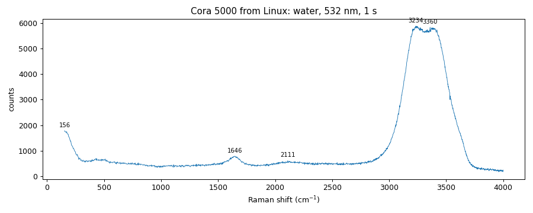

# cora-raman

Open, cross-platform software for the **Anton Paar Cora 5000** Raman spectrometer (BaySpec
hardware inside, 532 nm and 1064 nm lasers). The vendor software needs an old, never-updated
Windows; this project talks to the instrument directly over USB from Linux (and, later, Windows
and macOS), and adds what the vendor software lacks: scheduled scans and time series.

**Status: early.** The USB protocol is decoded and the first spectra have been measured from Linux
(532 nm). See [PROTOCOL.md](PROTOCOL.md) for everything known so far. The scripts here are test
tools, not the finished program.



## What's inside the instrument

A USB hub with: two BaySpec spectrometers (`ba8c:1688`, "BS2ACCD" for 532 nm and "BS2BASE" for
1064 nm), an I/O board on a Prolific serial port (power switching, 532 nm laser on/off), a CP210x
laser driver (1064 nm), and an MCP2200 that reports the state of the instrument's ARM button.
No vendor drivers are needed on Linux.

## Test scripts (Linux)

| Script | What it does | Laser |
|---|---|---|
| `probe.py` | Finds the devices and reads status | never |
| `dark.py` | Powers the spectrometers and takes one dark frame | never |
| `laser.py` | One 532 nm frame plus background (needs ARM pressed) | yes |
| `series.py` | Exposure/timing series at 532 nm | yes |
| `test1064.py` | One 1064 nm frame plus background | yes |

Requirements: `python3-serial`, `python3-usb`, membership in the `dialout` group, and the udev rule:

```
sudo cp 70-cora.rules /etc/udev/rules.d/ && sudo udevadm control --reload && sudo udevadm trigger
```

## Laser safety

The scripts only switch the laser on when the instrument is **armed** (the ARM button on the
instrument) and refuse to run without `--operator-present`. The instrument's own interlock cuts
the laser when the sample compartment is open. Always use your laboratory's laser precautions.

## Calibration

The wavelength calibration is instrument-specific. It is read from the vendor software's
`BS_System/BS_Device_Settings.ini` (copy it from the instrument PC); the values for the
development instrument are listed in PROTOCOL.md.

## License

MIT. Not affiliated with Anton Paar or BaySpec. The protocol was worked out from USB traffic
for interoperability with an instrument we own.
