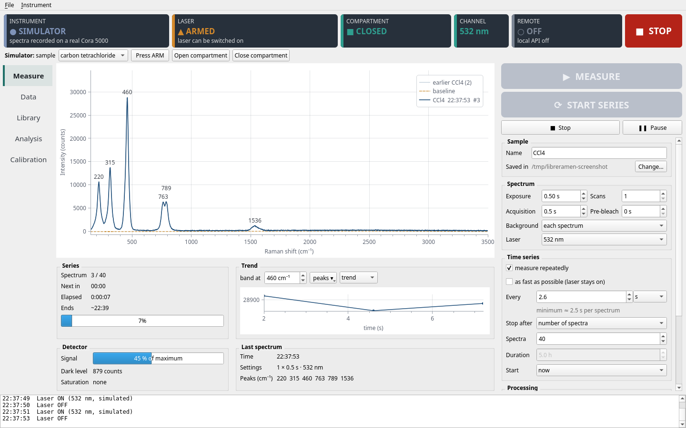

# LibreRamen

Open-source, cross-platform software for Raman spectrometers that deserve a second life.
The first supported instrument is the **Anton Paar Cora 5000** (BaySpec hardware inside, 532 nm
and 1064 nm lasers), whose vendor software needs an old, never-updated Windows. LibreRamen talks
to the instrument directly over USB from Linux, Windows 10/11 and macOS and adds what the
vendor software lacks: scheduled scans, time series and calibration against common standards.

*LibreRamen is an independent project, not affiliated with or endorsed by Anton Paar or BaySpec.
Product names are used only to describe compatibility.*

**Status: early.** The USB protocol is decoded and the engine (`libreramen` package plus command line)
measures spectra and time series from Linux at 532 nm; 1064 nm works but its axis isn't verified yet. See [PROTOCOL.md](PROTOCOL.md) for everything known so far. The scripts here are test
tools, not the finished program.



## Install

Installers of the **C++ version** (Qt 6, recommended) are attached to each
[release](https://github.com/ohlincha/libreramen/releases) (and to every CI run of *Build installers*):

| System | File | Notes |
|---|---|---|
| Windows 10 (1809+)/11, x64 | `LibreRamen-<version>-Windows-x64-Setup.exe` | also installs the USB drivers, see below |
| macOS 12+ (Apple Silicon and Intel) | `LibreRamen-<version>-macOS-universal.dmg` | drag LibreRamen to Applications |
| Ubuntu 24.04+, Debian 13+ | `libreramen_<version>_amd64.deb` | `sudo apt install ./libreramen_<version>_amd64.deb` |
| other Linux (Debian 12, Ubuntu 22.04, Fedora, …) | `LibreRamen-<version>-Linux-x86_64.AppImage` | `chmod +x` and run; udev rule see below |

The older **Python version** is still built as well: `LibreRamen-Setup-<version>.exe`, `LibreRamen-Windows.zip`,
`LibreRamenCLI-Windows.zip` (Windows) and `LibreRamen-macOS-Intel.dmg`. Both Windows installers install into the
same place; installing one replaces the other.

Every package contains the program `LibreRamen` and the command line `LibreRamenCLI`
(Windows: both in the installation folder; macOS: `LibreRamen.app/Contents/MacOS/LibreRamenCLI`;
Linux: `/usr/bin`). `LibreRamen --sim` starts with the simulator instead of the instrument.

### Windows

Run `LibreRamen-<version>-Windows-x64-Setup.exe` (C++) or `LibreRamen-Setup-<version>.exe` (Python) and accept
the administrator prompt: it also installs the USB drivers. The instrument's USB devices need Microsoft's generic WinUSB
driver; the installer binds it with [libwdi](https://github.com/pbatard/libwdi)'s `wdi-simple`
(the library behind Zadig), so nothing has to be downloaded separately:

- **spectrometers** (BaySpec `BA8C:1688`): always, also if the instrument isn't connected yet;
- **I/O board** (Prolific PL2303 `067B:2303`, which Prolific's current driver refuses as
  "PL2303HXA PHASED OUT"): only if it is connected and refused. Ordinary USB-serial cables use the same
  ID and keep their own driver; with several connected, unplug the others first;
- the MCP2200 (`04D8:00DF`, ARM button and compartment) uses Windows' own driver.

If the instrument was not connected during installation, or Windows Update later puts Prolific's driver
back, use **Instrument → Repair USB drivers…** (or *Start menu → LibreRamen → Repair USB drivers*).
A log is kept in `%ProgramData%\LibreRamen\drivers.log`. After this, the vendor software no longer
works on that PC.

### macOS

The app is not notarised (no paid Apple developer account), so macOS refuses the first start: open
*System Settings → Privacy & Security* and click **Open Anyway** (macOS 15), or right-click the app → **Open**
(macOS 12–14). Alternatively: `xattr -dr com.apple.quarantine /Applications/LibreRamen.app`. LibreRamen uses macOS's own
USB and serial drivers; nothing else is installed.

### Linux

The `.deb` installs a udev rule (`/usr/lib/udev/rules.d/70-libreramen.rules`) that gives the logged-in user
access to the spectrometers and the ARM button; the I/O board's serial port needs membership in the `dialout`
group (`sudo usermod -aG dialout $USER`, then log in again). With the AppImage, install the rule yourself:
`sudo cp 70-cora.rules /etc/udev/rules.d/ && sudo udevadm control --reload && sudo udevadm trigger`.
The AppImage's command line program is in the image: `./LibreRamen-*.AppImage --appimage-extract`, then
`squashfs-root/usr/bin/LibreRamenCLI`.

### From source (Python version)

```
python3 -m venv --system-site-packages .venv          # Debian/Ubuntu: don't pip into the system Python
.venv/bin/pip install PySide6 pyqtgraph numpy scipy pyserial pyusb
.venv/bin/python -m libreramen gui          # with the instrument
.venv/bin/python -m libreramen gui --sim    # simulator: spectra recorded on a real Cora 5000
```
The C++ version is built with CMake, see [cpp/README.md](cpp/README.md).

The full feature plan is in [docs/SPECIFICATION.md](docs/SPECIFICATION.md).

## What's inside the instrument

A USB hub with: two BaySpec spectrometers (`ba8c:1688`, "BS2ACCD" for 532 nm and "BS2BASE" for
1064 nm), an I/O board on a Prolific serial port (power switching, 532 nm laser on/off), a CP210x
laser driver (1064 nm), and an MCP2200 that reports the state of the instrument's ARM button.
No vendor drivers are needed on Linux.

## Engine (Python package `libreramen`)

```
python3 -m libreramen status                       # armed? compartment? spectrometers?
python3 -m libreramen init                         # vendor-style start-up (no laser)
python3 -m libreramen dark -e 1                    # dark frame, laser off
python3 -m libreramen acquire -e 1 -n 3            # 532 nm: 3 x 1 s, background-subtracted, CSV
python3 -m libreramen acquire --channel 1064 --power 200 -e 5
python3 -m libreramen series -e 1 --interval 10 --count 60 --background once
python3 -m libreramen shutdown                     # like the vendor's Shutdown
```

`--ini BS_Device_Settings.ini` loads the calibration of your own instrument (copy the file
from the vendor software's `BS_System` folder); without it, the development unit's values are used.

```python
from libreramen import Cora
c = Cora().connect(); c.initialize()
sp = c.acquire(exposure_s=1, averages=3)      # Spectrum: .shift, .intensity, .save_csv()
c.close()
```

## Test scripts (Linux, in `tools/`)

| Script | What it does | Laser |
|---|---|---|
| `probe.py` | Finds the devices and reads status | never |
| `dark.py` | Powers the spectrometers and takes one dark frame | never |
| `laser.py` | One 532 nm frame plus background (needs ARM pressed) | yes |
| `series.py` | Exposure/timing series at 532 nm | yes |
| `test1064.py` | One 1064 nm frame plus background | yes |

Requirements: `python3-serial`, `python3-usb`, membership in the `dialout` group, and the udev rule:

```
sudo cp 70-cora.rules /etc/udev/rules.d/ && sudo udevadm control --reload && sudo udevadm trigger
```

## Laser safety

The scripts only switch the laser on when the instrument is **armed** (the ARM button on the
instrument) and refuse to run without `--operator-present`. The instrument's own interlock cuts
the laser when the sample compartment is open. Always use your laboratory's laser precautions.

## Calibration

The program ships with a library of **reference standards**: the ASTM E1840 set (cyclohexane,
naphthalene, polystyrene, sulfur, paracetamol, benzonitrile, toluene/acetonitrile, indene), common
solvents (CCl₄, CHCl₃, CH₂Cl₂, toluene, benzene, acetonitrile, acetone, ethanol, methanol, isopropanol,
DMSO, ethylene glycol) and solids (silicon, diamond, calcite, anatase, rutile, PTFE, BaSO₄).
`python3 -m libreramen standards` lists them. Measure one or more of whatever your lab has and fit:

```
python3 -m libreramen calibrate --standard chloroform --standard ethanol     # guided, live
```

The program finds the peaks, matches them to the reference bands, fits a new pixel → Raman shift
polynomial, prints the residual of every band and, if you accept, stores it for that instrument.
With CCl₄, CHCl₃ and ethanol on the development unit: 19 of 19 bands matched, RMS 1.0 cm⁻¹
(factory calibration: about +2 cm⁻¹ off).

### Factory calibration

The wavelength calibration is instrument-specific. It is read from the vendor software's
`BS_System/BS_Device_Settings.ini` (copy it from the instrument PC); the values for the
development instrument are listed in PROTOCOL.md.

## License

MIT. The protocol was worked out from USB traffic for interoperability with an instrument we own.
