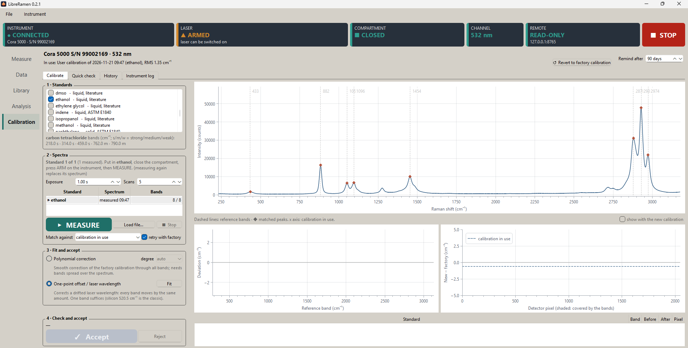

# LibreRamen — manual

This covers the desktop application (version 0.3.9). For the everyday steps see the [quick start](QUICKSTART.md);
for installation, the [README](../README.md). In the program both documents are under **Help**.

## The window

**Status bar (top).** Always visible:

| Tile | Meaning |
|---|---|
| INSTRUMENT | Connected instrument, model and serial number |
| LASER | *ARMED* once the ARM button on the instrument is pressed: only then can the laser be switched on |
| COMPARTMENT | *CLOSED* / *OPEN*: the instrument's interlock cuts the laser when the lid is open |
| CHANNEL | Laser channel in use (532 or 1064 nm) |
| REMOTE | State of the local API (used by scripts and the MCP server) |
| **STOP** | Switches the laser off and stops any measurement immediately |

**Desktop icon.** The Windows installer offers one (*Create a desktop shortcut*). On Linux, LibreRamen asks
the first time it starts; **File → Put an icon on the desktop** makes one at any time (from an AppImage it also
adds LibreRamen to the applications menu). On GNOME the desktop shows icons only with the *Desktop Icons NG*
extension.

**Areas (left).** Measure, Data, Library, Analysis and Calibration. The log at the bottom shows what the
program and the instrument did; the **Instrument** menu has *Reconnect*, *Use simulator*, *Shut down instrument…* and what to do with the
instrument when LibreRamen closes; **Help** has *Quick start* (F1) and this *Manual*.

> **Laser safety.** The laser only switches on when the instrument is armed and the compartment is closed —
> except in *Focus* mode, which also runs with the compartment open when the lid-open accessory is attached (a red
> warning stays on). Follow your laboratory's laser rules regardless: laser goggles with the lid open.

## Measure

1. Put the sample in, close the compartment, press **ARM** on the instrument.
2. Set exposure and number of scans, optionally *remove cosmic rays* and *smooth (Savitzky–Golay)*.
3. Press **▶ MEASURE** for one spectrum, or switch to *Time series* and press **⟳ START SERIES** for repeated
   spectra at a fixed interval (or *as fast as possible*, laser stays on). **❚❚ Pause** / **■ Stop** control
   the series.
4. To try a series without the instrument: **Instrument → Use simulator**, choose a *reaction:* sample in the
   simulator bar (its spectra change with time), press *Press ARM* and *Close compartment*. The sample
   *demo: sample changing under the laser* fades and shifts while the laser is on (to try the damage check).
5. During a series the *Trend* plot follows one peak; right-click a peak and choose *Use peak … for the trend*.

The sample name (box *Sample*) goes into the file names and the files. If it is empty, LibreRamen asks for one
when you press MEASURE or START SERIES; the last name is kept for the next start of the program, so change it
when you change the sample.

**Baseline** (the strip above the plot): the method, its strength, and whether the plot shows the raw spectrum,
the corrected one or both (the dashed line is the baseline), and whether the baseline and the earlier spectra
of the same sample (faded) are drawn. *arPLS* (strength 6) is the default; for *polynomial* the control is the order (1 = straight line). Cosmic-ray
removal, smoothing, intensity correction, normalisation and derivative are under *Processing* in the right
column.

The dashboard's *Fluorescence* line mentions a dominant fluorescence background (background at least as
high as the strongest band, e.g. ZnS); hover it for advice. The default *arPLS* baseline handles such samples.

**Laser-damage check.** Dark samples (carbon, LiFePO₄, layered oxides) can heat and change under the laser while
they are measured; the averaged spectrum then looks clean but is wrong. Whenever a spectrum has 2 or more scans,
LibreRamen compares the first third of the scans with the last third: did the strongest bands move (more than
2.5 cm⁻¹), lose height (more than 15 %), or did the background rise (more than 20 % of the strongest band or of
the background)? Nothing is shown while all is well. If the check fires, a *Laser* line appears in the dashboard:
*sample changing under the laser: shorten the exposure or defocus slightly (distance knob)* (hover it for the
numbers), and the file gets `# laser_damage: suspected` with the details in `# laser_damage_check`. The Cora's
laser power cannot be changed, so shorter exposures, more scans and a slightly defocused beam are the remedies.
Every saved spectrum also records its signal-to-noise ratio (`# snr`, strongest band). The thresholds are first
guesses, not yet checked on the real instrument.

### Acquire until S/N

**Measure → Acquire until S/N…** keeps adding short frames until a band reaches a target signal-to-noise ratio:
for weak or heat-sensitive samples, instead of guessing exposure × scans. Set the *Target S/N* (100 by default;
S/N grows with the square root of the number of frames), the *Band* (the strongest, or one at a given shift),
the *Frame exposure* and a *Time limit*. A background (laser off) is taken first; then the window shows the running
S/N, the frames so far, the time and about how many frames are still needed. It stops when the target is reached,
at the time limit, with **■ Stop**, or — with *stop if the sample changes under the laser* — when the damage check
fires. The mean is saved and shown like a normal spectrum (`# mode: until S/N`, `# stop_reason`, `# snr`). Sample
name, folder, background and laser come from the Measure page.

### Repeated measurements of one vial

A powder is not the same everywhere and the laser sees one spot. **Measure → Repeated measurements…** measures the
vial N times (5 by default) with the Measure page's settings. After each spectrum it asks you to *shake or rotate
the vial, put it back and close the lid* (press ARM again after opening), then **Continue** (or **Finish now**).
At the end it shows all spectra and their mean, a table of the spectra and the strongest bands of the mean as
**mean ± sd**: position, height (with its relative spread) and the ratio to the strongest band (independent of how
the powder is packed). A spectrum whose shape differs much from the others (e.g. a burnt spot; shape distance
above 0.10 and far outside the spread of the rest) is flagged; untick *Use* to leave a spectrum out, and the
results and files are updated. Every spectrum is saved as usual (`# repeat: 2/5`); in addition
`<sample>_mean_<time>.csv` (the mean, with the band results in its header) and `<sample>_repeats_<time>.csv`
(mean, sd and every spectrum as columns, band results, which were excluded).

Spectra are saved automatically (*Saved in* shows the folder); a series is saved as a folder with one CSV per spectrum plus `series.csv`.
**Add to library…** in the *Last spectrum* box stores the newest spectrum in the library; the **⋯** menu
has *Clear*.

### Focus mode

**◎ Focus…** (below Stop on the Measure page) opens a window for setting the sample distance with the instrument's
distance knob. **START FOCUS** takes a dark background, switches the laser on and keeps it on, and measures short
spectra one after another (*Exposure*, 0.2 s by default). For each spectrum it shows

- the **strongest band**: its height above the background and where it is (or the band at *Follow band*), and
- the **total Raman signal**: everything above the background and the noise, 200–3200 cm⁻¹,

each with the **best so far** and a bar showing how close the current spectrum is to it, a trend of the last minute
(% of the best) and the live spectrum. Turn the knob slowly until the numbers peak, and go back to the best.
*Saturated* means the exposure is too long. Nothing is saved, except with **Keep this spectrum** (a CSV in the
Measure folder). The laser goes off with **STOP**, Esc, closing the window, or after *Laser off after* (5 min).

With the **lid-open accessory** the laser can run with the lid open. The accessory most likely makes the lid read
closed, so LibreRamen cannot tell: while Focus mode has the laser on, a red banner always warns that the lid may be
open — wear laser goggles. (If the compartment does read open, Focus mode still runs, normal measurements do not.)
The instrument must be armed. Not yet tried with the real accessory; the simulator's *Lid-open accessory* box
assumes that ARM works and stays on with the lid open.

## Data

Open spectra (CSV, TXT, SPC, JCAMP-DX, vendor files) and compare them: overlay, waterfall or heat map.

- **Processing:** baseline correction, normalisation, derivative, *difference A − B*, and a **Calculator…**
  for arbitrary expressions.
- **Baseline:** *as Measure page* (default) follows the Measure page's method and strength; or pick a method
  and a strength (0–10, larger = stiffer) for the Data page alone:

  | Method | Use for |
  |---|---|
  | arPLS (default, strength 6) | clean and fluorescent samples alike (CCl₄, ZnS); keeps band areas within a few % |
  | Polynomial, order 1 (straight line) | clean samples on a flat or sloping background; the simplest to report |
  | Polynomial, higher order | smooth curved backgrounds; higher orders can cut into broad bands |
  | Rolling ball | narrow bands on a flat background; cannot follow fluorescence |
  | SNIP, SNIP 4th order, ALS, airPLS | for comparison; on fluorescent samples they leave part of the background under the bands |

  On a synthetic ZnS spectrum with a known background, arPLS kept the band areas within ~10 %; SNIP 4th order
  (the default up to 0.3.1) inflated them by 30–160 % and cut a quarter off the 218 cm⁻¹ band of CCl₄.

  Baselines are fitted from the shift in *fit from* upwards (default 150 cm⁻¹): below it the laser filter cuts
  the signal, and that edge would otherwise pull the baseline down beside low-wavenumber bands (ZnS 256/348
  cm⁻¹). For imported spectra from other instruments with real bands below 150 cm⁻¹, set it to 0. The page's
  baseline method, strength and *fit from* are kept for the next start of the program.
- **Peaks:** peaks are picked automatically; click the plot to add one, right-click near one to remove it.
- **Fitting:** zoom in on the bands of interest and press **Fit peaks in view**. The fitted window is shaded;
  drag it or its edges to fit another range. The table gives position, height, FWHM and area per band.
- **Carbon D/G** (**Tools ▸ Carbon D/G analysis…**, or right-click the plot): D and G bands of carbons (anodes,
  conductive carbons, chars) in the current spectrum as shown (baseline-corrected), fitted in 950–1800 cm⁻¹ with
  a linear baseline. Models: *D Lorentzian + G Breit–Wigner–Fano* (D′ ~1620 cm⁻¹ is added when resolved) or
  *Sadezky five-band* (G, D1, D2 = D′, D4 Lorentzian, D3 Gaussian; I_D/I_G is then D1/G). The window lists
  I_D/I_G by height and by area, positions, FWHM, heights and areas with standard errors, the crystallite size
  L_a and, if the spectrum reaches 2800 cm⁻¹, the 2D band (~2700 cm⁻¹) with I_2D/I_G. **Copy** (tab-separated, for
  a spreadsheet) or **Save CSV…**; the fit is drawn on the plot and the peak table/peak CSV export list the bands.
  - G (BWF): I(ω) = I₀(1 + 2(ω−ω₀)/(qΓ))² / (1 + (2(ω−ω₀)/Γ)²). The reported G position is the **maximum**
    ω₀ + Γ/(2q), not ω₀ (also listed). q < 0 puts the tail on the low-shift side (Ferrari & Robertson); a large
    |q| is a Lorentzian. The BWF area is taken above its asymptote I₀/q²: π I₀ Γ (1 − 1/q²)/2.
  - L_a (nm) = 2.4·10⁻¹⁰ λ⁴ / (I_D/I_G) from the **area** ratio (Cançado et al. 2006), λ = 532 nm: 19.2 nm / (I_D/I_G).
    Valid for nanocrystalline graphite (L_a ≳ 2 nm); for amorphous carbon it is meaningless.
  - For a series, use the *Carbon* quantities in **Analysis ▸ Peak trends**.
- **Band help:** tick *organic*, *inorganic* or both (mixed samples) to show the typical Raman ranges of
  functional groups, ions, minerals and oxides above the spectrum (about 290 entries; zoom in to see more, hover
  a bar for details). The peak table then lists possible assignments for every peak, most specific first, and
  the peak CSV export includes them. Ranges are typical values; positions shift with phase, hydrogen bonding
  and neighbouring groups. The table is `cpp/resources/band_assignments.csv`.
- **Add to library…** (next to *Calculator…*): the ticked spectrum; with several ticked you choose which.
- **Match:** identifies the ticked spectrum (with several ticked you choose which): the Library area opens on
  its *Match* tab with the spectrum as the query and the library entries ranked against it.
- **Export:** ticked spectra as CSV, JCAMP-DX (one or multi-block), SPC or one table on a common axis; the
  peak table as CSV; the plot as PNG or SVG.

## Library

A spectral library is an SQLite file (**New library…**, **Open…**). Add spectra from Data or Measure, from
files, or import a RRUFF folder. Select a spectrum and press **Match** to rank the library entries against
it; *Filters* narrow the search. Three methods: **Full spectrum** (the default) correlates the whole spectra (hit quality index) and copes
best with fluorescence and broad or overlapping bands; **Peaks** compares peak positions with every entry's peak
or band list; **Mixture** fits 1–3 of the best full-spectrum hits. In full-spectrum search, entries
that only have a band list are compared with a spectrum drawn from their bands, using the typical peak width of
your spectrum; such hits are marked *(band list)*. The method you choose is remembered. Matching removes the baseline with *arPLS* by default, so fluorescent
samples are still matched to clean reference spectra (classic SNIP left part of the fluorescence behind and
matched them to the wrong entry).

**Reference entries.** The default library comes with literature reference entries: band positions of battery
materials (cathodes, carbons and anodes, binders and cellulose, electrolyte salts and anions, SEI products), carbonate
electrolytes (EC, PC, DMC, EMC, DEC, FEC, VC, the Li⁺-solvated EC and PC bands, LP30, the BF₄⁻ and ClO₄⁻
ion-pairing bands, LiBOB, LiDFOB), lignocellulose for paper separators (softwood and grass lignin, xylan, glucomannan, pectin, unbleached kraft pulp, carotenoids; cellulose I and II are with the binders), common
solvents (water, alcohols, acetone, acetonitrile, DMSO, DMF, chlorinated and aromatic solvents, alkanes) and the
ASTM E1840 shift standards (cyclohexane, paracetamol, naphthalene, polystyrene, sulfur, toluene). Band-list
entries come with their sources (DOIs), the excitation laser, notes on composition and phase, and a confidence. Most bands carry a
relative intensity; where the source gave none, it is an estimate of typical published spectra (noted in the
entry); class *Literature*, tag *reference*. The default library also
has measured spectra from open data sets, usable with full-spectrum search: 42 polymers at 532 nm (PE, PP, PTFE, PVDF,
nylon, PET, PMMA, polyimide, cellulose and more; Miller et al. 2022, CC BY 4.0), 421 minerals and inorganic compounds from the Raman Open Database (quartz, glass,
sapphire, calcite, gypsum, TiO₂, metal oxides and more; CC0, mostly 532 nm) and 7 battery-interphase compounds at
488 nm (Li₂CO₃, LiPF₆, Li₂O, lithium acetate, MnF₂, NiF₂, PEO; Karapin-Springorum et al. 2025, CC0). The licence
and citation are in each entry. New versions of
LibreRamen add new reference entries to the default library; entries you edited are kept. **Library ▸ Add
reference entries** adds them to any other library. Peak tables picked automatically by an older version (0.3.1 or older) are
re-picked the same way the first time the library is opened for writing; edited peak tables are kept.

## Analysis

Multivariate analysis of a data set (e.g. a time series): **PCA**, **EFA**, **MCR-ALS** (with
non-negativity, unimodality and closure constraints), **NNLS fit** against known spectra, and **Peak trends**
(band areas vs time with kinetic fits). Peak trends also offer the carbon D/G quantities *Carbon I_D/I_G
(area)*, *(height)*, *Carbon L_a* and *Carbon G position* (D Lorentzian + G BWF as in **Tools ▸ Carbon D/G
analysis…**; the fit region is the band's range if it spans 1300–1620 cm⁻¹, else 950–1800 cm⁻¹). Computed spectra from Gaussian, ORCA, xtb and others can be loaded for
comparison.

## Calibration

The Raman shift axis comes from the instrument's **factory calibration**. For an instrument other than the development unit, load its
`BS_Device_Settings.ini` (vendor software, `BS_System` folder) once with **Instrument → Load factory
calibration…**; it is stored per serial number and used whenever that instrument is connected. A user calibration corrects it
using one or more reference standards. The header shows which calibration is in use; **Revert to factory
calibration** returns to the factory one at any time.

### Steps

1. **Standards.** Tick the standard(s) you have. Below the list are the reference bands of the selected one.
2. **Spectra.** Put the standard in, close the compartment, arm, press **MEASURE** (or *Load file…*). The
   table shows how many reference bands were found. Repeat for each ticked standard.
3. **Fit.** Choose the kind of calibration and press **Fit**:
   - *Polynomial correction*: a smooth correction to the factory calibration. *Degree auto* picks offset,
     linear, quadratic or cubic depending on how many bands there are and how much of the detector they cover.
   - *One-point offset / laser wavelength*: every band moves by the same amount, equivalent to a slightly
     different laser wavelength. One band is enough (silicon 520.5 cm⁻¹ is the classic).
4. **Check and accept.** The checklist must pass before **Accept** is enabled.

### Reading the plots

- **Spectrum (top):** dashed lines are the reference bands, diamonds the matched peaks.
- **Deviation (bottom left):** residual of each band, for the calibration in use and for the new fit.
- **Whole detector (bottom right):** new calibration minus factory over every pixel. The **shaded range**
  is covered by the bands; outside it the correction is extrapolated. The dashed line is the calibration in
  use. A good calibration is a small, smooth curve. A curve that swings by several cm⁻¹ between the bands is
  a bad one, even if its band residuals are small.

### Choosing standards

- Bands should be **sharp** and **spread over the whole range** you measure. A gap with no bands (ethanol has
  none between 1460 and 2870 cm⁻¹) leaves the correction unconstrained there.
- The **ASTM E1840** standards (cyclohexane, paracetamol, naphthalene, polystyrene, …) have certified band
  positions; solvents marked *literature* are fine but less exact.
- Combining standards helps: e.g. CCl₄ for the low end (218–790 cm⁻¹) plus cyclohexane or paracetamol.
- With only one standard, or a small correction, a **one-point offset** is the safe choice.

### Checking a calibration

**Quick check** measures a standard and compares it with the calibration in use without changing anything.
**History** lists all calibrations of the instrument (make an older one active again, or revert to factory).
*Remind after* sets when the program asks for a new check.

### Intensity correction

The detector, grating and filters don't respond equally at every wavelength, so band intensities far apart in
the spectrum (2D/G in carbons, or ratios of bands at 500 and 3000 cm⁻¹) depend on the instrument. The
**Intensity** tab measures a reference with a known emission curve and computes a correction factor:

| Reference | True curve |
|---|---|
| NIST SRM 2242 glass (532 nm) | the certified polynomial; the same coefficients are in the instrument's factory file |
| Tungsten-halogen lamp | blackbody (Planck) curve at the lamp's colour temperature, a few % approximation |
| Table from a file | two columns: Raman shift (cm⁻¹) and relative intensity, e.g. from a certificate |

1. Put the reference in the sample position, choose it, and press **▶ MEASURE REFERENCE** (or **Use a saved
   spectrum…**). Use an exposure that keeps the signal well below saturation; the reference must reach S/N ≥ 50.
2. Check the plots: measured vs true curve (the valid range is shaded) and the correction factor next to the one
   in use. Warnings appear if the factor varies more than 30-fold or covers less than 1500 cm⁻¹.
3. **Accept** stores it for this instrument and channel (`response_<serial>_<channel>.json` next to the
   calibration files, with a dated history copy). **Remove correction** stops using it.

Tick **intensity correction** in Measure (Processing) or on the Data page to apply it. Raw data are never
changed; saved spectra carry the instrument's serial number, so the Data page corrects each file with its own
instrument's response. Outside the valid range the factor at the nearest end is used.
