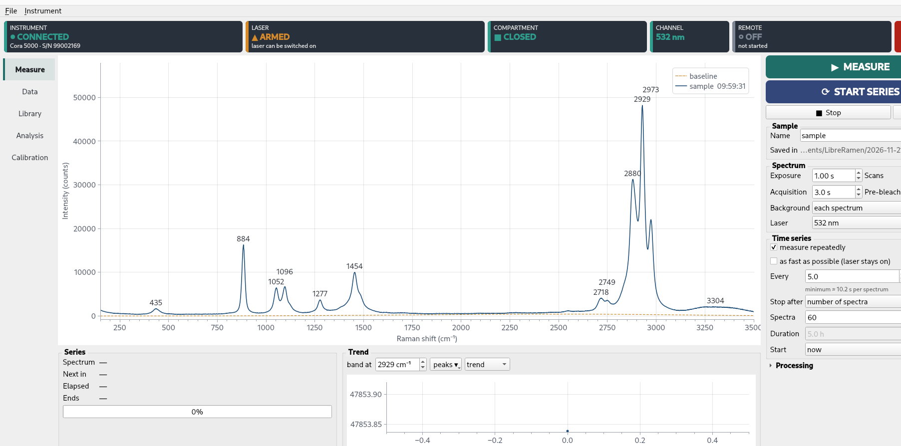

# LibreRamen — quick manual

This covers the desktop application (version 0.2.1). For installation see the [README](../README.md).

## The window

**Status bar (top).** Always visible:

| Tile | Meaning |
|---|---|
| INSTRUMENT | Connected instrument, model and serial number |
| LASER | *ARMED* once the ARM button on the instrument is pressed: only then can the laser be switched on |
| COMPARTMENT | *CLOSED* / *OPEN*: the instrument's interlock cuts the laser when the lid is open |
| CHANNEL | Laser channel in use (532 or 1064 nm) |
| REMOTE | State of the local API (used by scripts and the MCP server) |
| **STOP** | Switches the laser off and stops any measurement immediately |

**Areas (left).** Measure, Data, Library, Analysis and Calibration. The log at the bottom shows what the
program and the instrument did; the **Instrument** menu has *Reconnect*, *Use simulator*, *Shut down instrument…* and what to do with the
instrument when LibreRamen closes.

> **Laser safety.** The laser only switches on when the instrument is armed and the compartment is closed.
> Follow your laboratory's laser rules regardless.

## Measure

1. Put the sample in, close the compartment, press **ARM** on the instrument.
2. Set exposure and number of scans, optionally *remove cosmic rays* and *smooth (Savitzky–Golay)*.
3. Press **▶ MEASURE** for one spectrum, or switch to *Time series* and press **⟳ START SERIES** for repeated
   spectra at a fixed interval (or *as fast as possible*, laser stays on). **❚❚ Pause** / **■ Stop** control
   the series.
4. During a series the *Trend* plot follows one peak; right-click a peak and choose *Use peak … for the trend*.

Spectra are saved automatically (*Saved in* shows the folder); a series is saved as a folder with one CSV per spectrum plus `series.csv`.
The **⋯** menu has *Clear* and *Add to library…*.

## Data

Open spectra (CSV, TXT, SPC, JCAMP-DX, vendor files) and compare them: overlay, waterfall or heat map.

- **Processing:** baseline correction, normalisation, derivative, *difference A − B*, and a **Calculator…**
  for arbitrary expressions.
- **Peaks:** peaks are picked automatically; click the plot to add one, right-click near one to remove it.
- **Fitting:** zoom in on the bands of interest and press **Fit peaks in view**. The fitted window is shaded;
  drag it or its edges to fit another range. The table gives position, height, FWHM and area per band.
- **Export:** ticked spectra as CSV, JCAMP-DX (one or multi-block), SPC or one table on a common axis; the
  peak table as CSV; the plot as PNG or SVG.

## Library

A spectral library is an SQLite file (**New library…**, **Open…**). Add spectra from Data or Measure, from
files, or import a RRUFF folder. Select a spectrum and press **Match** to rank the library entries against
it; *Filters* narrow the search.

## Analysis

Multivariate analysis of a data set (e.g. a time series): **PCA**, **EFA**, **MCR-ALS** (with
non-negativity, unimodality and closure constraints), **NNLS fit** against known spectra, and **Peak trends**
(band areas vs time with kinetic fits). Computed spectra from Gaussian, ORCA, xtb and others can be loaded for
comparison.

## Calibration

The Raman shift axis comes from the instrument's **factory calibration**. A user calibration corrects it
using one or more reference standards. The header shows which calibration is in use; **Revert to factory
calibration** returns to the factory one at any time.

### Steps

1. **Standards.** Tick the standard(s) you have. Below the list are the reference bands of the selected one.
2. **Spectra.** Put the standard in, close the compartment, arm, press **MEASURE** (or *Load file…*). The
   table shows how many reference bands were found. Repeat for each ticked standard.
3. **Fit.** Choose the kind of calibration and press **Fit**:
   - *Polynomial correction*: a smooth correction to the factory calibration. *Degree auto* picks offset,
     linear, quadratic or cubic depending on how many bands there are and how much of the detector they cover.
   - *One-point offset / laser wavelength*: every band moves by the same amount, equivalent to a slightly
     different laser wavelength. One band is enough (silicon 520.5 cm⁻¹ is the classic).
4. **Check and accept.** The checklist must pass before **Accept** is enabled.

### Reading the plots

- **Spectrum (top):** dashed lines are the reference bands, diamonds the matched peaks.
- **Deviation (bottom left):** residual of each band, for the calibration in use and for the new fit.
- **Whole detector (bottom right):** new calibration minus factory over every pixel. The **shaded range**
  is covered by the bands; outside it the correction is extrapolated. The dashed line is the calibration in
  use. A good calibration is a small, smooth curve. A curve that swings by several cm⁻¹ between the bands is
  a bad one, even if its band residuals are small.

### Choosing standards

- Bands should be **sharp** and **spread over the whole range** you measure. A gap with no bands (ethanol has
  none between 1460 and 2870 cm⁻¹) leaves the correction unconstrained there.
- The **ASTM E1840** standards (cyclohexane, paracetamol, naphthalene, polystyrene, …) have certified band
  positions; solvents marked *literature* are fine but less exact.
- Combining standards helps: e.g. CCl₄ for the low end (218–790 cm⁻¹) plus cyclohexane or paracetamol.
- With only one standard, or a small correction, a **one-point offset** is the safe choice.

### Checking a calibration

**Quick check** measures a standard and compares it with the calibration in use without changing anything.
**History** lists all calibrations of the instrument (make an older one active again, or revert to factory).
*Remind after* sets when the program asks for a new check.
