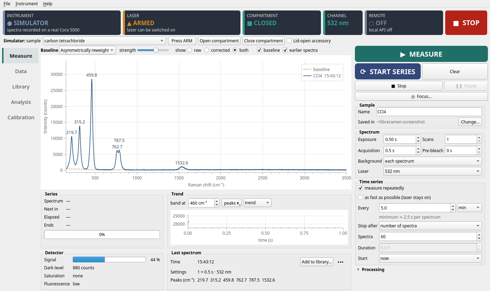
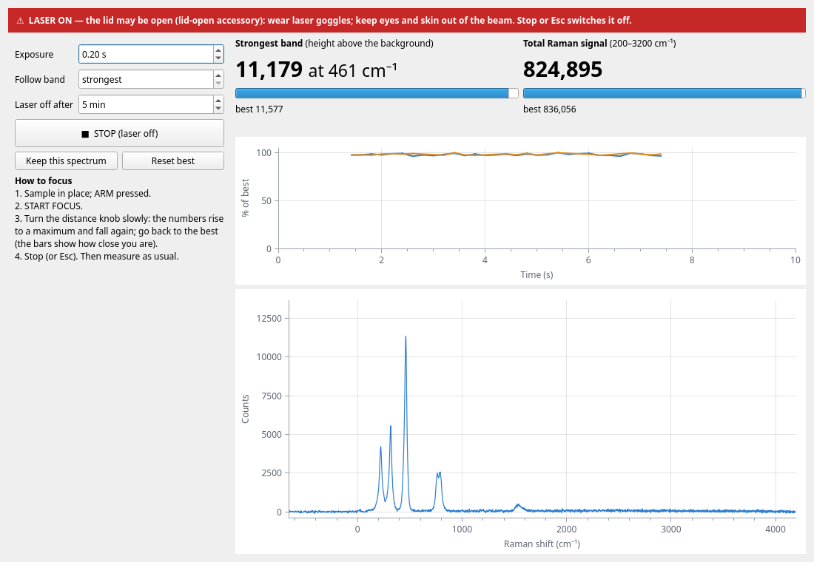
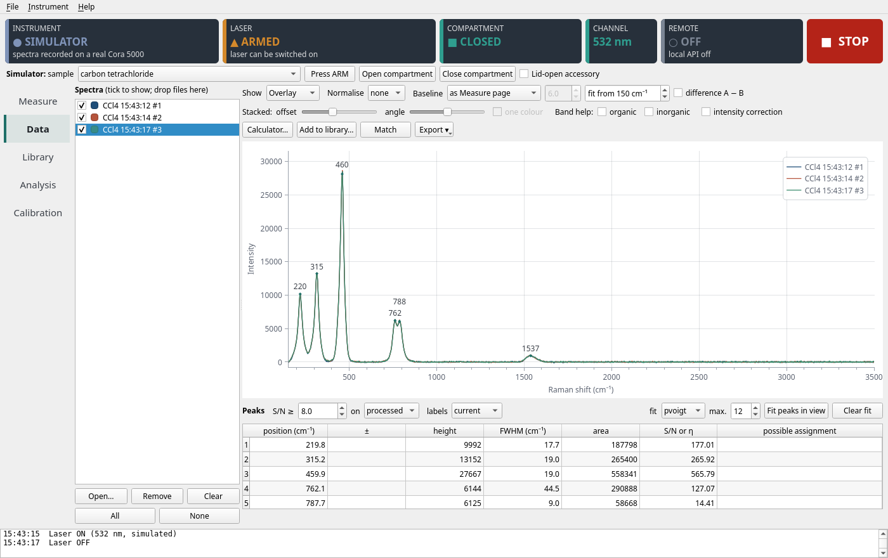

# LibreRamen — quick start

For students and technicians measuring on the Anton Paar Cora 5000 with LibreRamen (version 0.3.9). It covers
the everyday steps; everything else is in the [full manual](MANUAL.md). In the program both are under **Help**.

## 1. Install

Download the installer for your computer from the
[releases page](https://github.com/ohlincha/libreramen/releases):

| Computer | File | How |
|---|---|---|
| Windows 10/11 | `LibreRamen-…-Windows-x64-Setup.exe` | run it and accept the administrator prompt (it also installs the USB drivers) |
| macOS 12+ | `LibreRamen-…-macOS-universal.dmg` | drag LibreRamen to *Applications*; the first start needs *System Settings → Privacy & Security → Open Anyway* |
| Ubuntu 24.04+, Debian 13+ | `libreramen_…_amd64.deb` | `sudo apt install ./libreramen_…_amd64.deb` (in the download folder) |
| other Linux | `LibreRamen-…-Linux-x86_64.AppImage` | `chmod +x` it and run it |

On Linux, also run `sudo usermod -aG dialout $USER` once and log in again (access to the instrument's serial port).
Details are in the [README](../README.md#install).

## 2. Start and connect

1. Switch the instrument on and connect its USB cable.
2. Start **LibreRamen**. It finds the instrument by itself and switches it on (this can take about a minute;
   meanwhile the INSTRUMENT tile shows *INITIALISING…*).
3. Read the **status strip** at the top. It is always visible:

| Tile | What you want to see | If not |
|---|---|---|
| INSTRUMENT | **● CONNECTED** with model and serial number | *NOT FOUND*: see Troubleshooting |
| LASER | **▲ ARMED** (orange) — the laser *can* be switched on | *NOT ARMED*: press **ARM** on the instrument |
| COMPARTMENT | **■ CLOSED** | *OPEN*: close the lid; the laser is disabled |
| CHANNEL | **532 nm** | (1064 nm is not usable on our instrument) |
| **STOP** (red) | — | switches the laser off and stops everything, at any time |

While the laser is on, the LASER tile turns red: **✹ LASER ON**.

To practise without the instrument: **Instrument → Use simulator** (or start `LibreRamen --sim`). The simulator
bar below the status strip has *Press ARM*, *Open/Close compartment* and a choice of samples.

## 3. Laser safety

- The laser only switches on when the instrument is **armed** (ARM button) and the compartment reads **closed**;
  it is only on during a measurement. The instrument's own interlock cuts it when the lid is opened.
- **Focus mode is different:** it keeps the laser **on continuously** until you stop it.
- With the **lid-open accessory** attached, the laser can run **with the lid open**. The accessory makes the lid
  read closed, so LibreRamen cannot tell; in Focus mode a red banner always warns *the lid may be open*.
  **Wear laser goggles** whenever the lid may be open, and keep eyes and skin out of the beam.
- Laser power is set by hand on the instrument, not by the program.
- Follow your laboratory's laser rules. When in doubt, press **STOP** (or Esc in the Focus window).

## 4. Measure one spectrum

1. Put the sample vial in, close the compartment, press **ARM** on the instrument.
2. **Sample → Name:** type the sample name. It goes into the file name, so the spectrum can be found later.
   (If it is empty, LibreRamen asks for one. The name is kept for next time, so change it for each new sample.)
3. **Spectrum:** set **Exposure** (seconds per scan) and **Scans** (how many are averaged). Leave *Background*
   at *each spectrum* (a dark frame with the laser off is subtracted) and *Laser* at *532 nm*.
4. Press **▶ MEASURE**. The laser is on only during the measurement; the spectrum appears with its peaks labelled.
5. Check the **Detector** box under the plot: *Saturation* should say *none*. If it is saturated, shorten the
   exposure (or turn the laser power down on the instrument). If the signal is weak, focus first (section 5),
   then use a longer exposure or more scans.

**Where the files go.** Every spectrum is saved automatically as a CSV file named
`<sample>_<yyyyMMdd>_<HHmmss>.csv` in the folder shown under *Saved in* — by default
`Documents/LibreRamen/<today's date>` in your home folder (a new folder each day). **Change…** picks another
folder. The new spectrum is also added to the **Data** area.

## 5. Focus the sample (set the distance)

The signal depends strongly on the distance between the sample and the optics. Set it with the instrument's
distance knob while LibreRamen shows the signal live:

1. Sample in place, compartment closed, **ARM** pressed.
2. On the Measure page press **◎ Focus…** (below *Stop*). The Focus window opens.
3. Press **◎ START FOCUS**. The laser stays **on**; short spectra (0.2 s) follow one another.
4. Turn the **distance knob slowly**. Watch the two big numbers — the **strongest band** and the **total Raman
   signal** — and the bars showing how close you are to the **best so far**. The numbers rise to a maximum and
   fall again; go back to the best position.
5. Press **■ STOP (laser off)** (or Esc, or close the window). Then measure as usual (section 4).

*Saturated* means the exposure is too long: lower *Exposure*. Nothing is saved unless you
press **Keep this spectrum**. The laser also goes off by itself after *Laser off after* (5 min).

## 6. A time series (briefly)

For spectra repeated at a fixed interval (reactions, drying, ageing):

1. Under **Time series**, keep **measure repeatedly** ticked.
2. Set **Every** (number and unit s/min/h) and **Stop after** a *number of spectra* or a *duration*. The grey line
   shows the shortest possible interval for your exposure and scans; *as fast as possible* keeps the laser on.
3. Press **⟳ START SERIES**. **❚❚ Pause** and **■ Stop** control the series; the *Series* box shows progress and
   the *Trend* plot follows one band (right-click a peak → *Use peak … for the trend*).

A series is saved as its own folder (one CSV per spectrum plus `series.csv`) inside the *Saved in* folder.

## 7. Look at and export data (Data area)

1. Click **Data** on the left. Spectra just measured are already in the list; **Open…** (or drag files onto the
   list) adds saved ones (CSV, TXT, SPC, JCAMP-DX, vendor files).
2. Tick the spectra to show. **Show:** *Overlay*, *Stacked* or *Heat map*; **Normalise:** *none*, *max* or *area*.
3. The baseline is removed as on the Measure page (*as Measure page*; arPLS by default). Peaks are picked
   automatically and listed in the **Peaks** table; click the plot to add a peak, right-click near one to
   remove it. Zoom in on bands and press **Fit peaks in view** for position, height, width (FWHM) and area.
4. **Export ▾:** the ticked spectra as CSV, JCAMP-DX, SPC or one table on a common axis; the peak table as CSV;
   the plot as PNG or SVG (for reports).
5. **Match** looks the ticked spectrum up in the spectral library (Library area).

## 8. Check the calibration with a standard (briefly)

The Raman-shift axis should be checked now and then (the program reminds you; default every 90 days).

1. **Calibration** on the left → tab **Quick check**.
2. Choose the **Standard** you have (e.g. *chloroform*, *cyclohexane*, *polystyrene*; its reference bands are listed),
   put it in, close the compartment, press **ARM**.
3. Press **▶ CHECK**. The result says **✓ Calibration OK** or **⚠ Recalibration recommended**, with the band
   deviations (RMS, in cm⁻¹, compared with *Tolerance*, default 2 cm⁻¹). The quick check changes nothing.
4. If recalibration is recommended, ask the person responsible for the instrument, or follow the *Calibrate* tab
   (see the [manual](MANUAL.md), section *Calibration*).

## 9. Troubleshooting

| Problem | What to do |
|---|---|
| INSTRUMENT: *NOT FOUND* | Is the instrument on and the USB cable in? **Instrument → Reconnect**. Windows: **Instrument → Repair USB drivers…**. Linux (AppImage): install the udev rule (README); serial port: `dialout` group, then log in again |
| INSTRUMENT: *CONNECTION LOST* | Check the USB cable, then **Instrument → Reconnect** |
| MEASURE does nothing / laser won't switch on | LASER must read *ARMED* (press ARM) and COMPARTMENT *CLOSED* |
| *Saturation* in the Detector box, flat-topped peaks | Shorter exposure, or lower laser power on the instrument |
| Weak or no peaks | Focus (section 5); longer exposure, more scans; is the vial in place? |
| Large sloping background (*Fluorescence* line) | Normal for some samples; the default arPLS baseline removes it. Hover the line for advice |
| *Interval too short* when starting a series | Exposure × scans plus backgrounds take longer than the interval: lengthen *Every* or shorten the exposure |
| "LibreRamen is already running" | The open window was brought to the front; use that one |
| Peaks at slightly wrong positions | Run a calibration quick check (section 8) |
| Something else | The log at the bottom of the window shows what the program and the instrument did; copy it when you ask for help |

When you are done: **File → Quit**. LibreRamen asks whether to shut the instrument down or leave it on
(*Instrument → When closing LibreRamen* sets the default).
